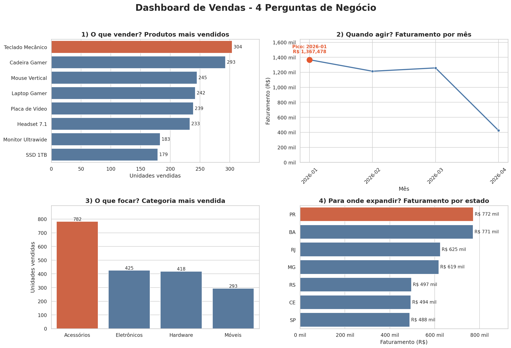

<h1 align="center">📊 Análise de Vendas | Do dado bruto à decisão</h1>

<p align="center">
  Projeto prático do curso da <b>Data Science Academy (DSA)</b>: geração de dados fictícios, transformação, análise, visualização e insights para decisões de negócio.
</p>

<p align="center">
  
  
  
  
  
</p>

---

## 🎯 Sobre o projeto

Uma empresa **fictícia** de produtos de tecnologia precisa de apoio para tomar decisões. Para isso, geramos uma base com **500 pedidos de vendas** (dados aleatórios, criados com Python) e usamos o ciclo completo de análise de dados para responder quatro perguntas de negócio:

| Pergunta | Como foi respondida |
|---|---|
| 🛒 **O que vender?** | Produtos com mais unidades vendidas |
| 📅 **Quando agir?** | Mês com maior faturamento |
| 🎯 **O que focar?** | Categoria com mais unidades vendidas |
| 🗺️ **Para onde expandir?** | Estado com maior faturamento |

> ⚠️ **Todos os dados são fictícios.** Os resultados servem para praticar a técnica, não representam nenhuma empresa real.

## 📈 Dashboard



## 💡 Insights

- **O que vender:** o **Teclado Mecânico** lidera em unidades (304), seguido de perto pela Cadeira Gamer (293).
- **Quando agir:** **janeiro/2026** foi o mês de maior faturamento (R$ 1,37 milhão). Fevereiro e março ficaram próximos; abril tem dados parciais (a base termina em 10/04).
- **O que focar:** **Acessórios** vendem quase o dobro da segunda categoria (782 unidades contra 425 de Eletrônicos).
- **Para onde expandir:** **Paraná (PR)** lidera o faturamento (R$ 772 mil), praticamente empatado com a **Bahia (BA)**, com R$ 771 mil.

**Observações de leitura:** "mais vendido" aqui significa *unidades*, o que favorece itens baratos vendidos em volume. Para priorizar receita, basta trocar `Quantidade` por `Faturamento` nas análises de produto e categoria.

## 🧰 Tecnologias

- **Python**: linguagem principal
- **Pandas / NumPy**: geração, transformação e agregação dos dados
- **Matplotlib / Seaborn**: visualização e dashboard

## 🗂️ Estrutura do repositório

```
analise-vendas-dsa/
├── data/
│   └── vendas.csv            # base de vendas fictícias
├── images/
│   └── dashboard_vendas.png  # dashboard gerado
├── src/
│   ├── gerar_dados.py        # gera o CSV com dados fictícios
│   └── analise_vendas.py     # responde as 4 perguntas e monta o dashboard
├── requirements.txt
├── LICENSE
└── README.md
```

## ▶️ Como executar

```bash
# 1. Clone o repositório
git clone https://github.com/SEU-USUARIO/analise-vendas-dsa.git
cd analise-vendas-dsa

# 2. (Opcional) Crie um ambiente virtual
python -m venv .venv
source .venv/bin/activate        # Windows: .venv\Scripts\activate

# 3. Instale as dependências
pip install -r requirements.txt

# 4. Rode a análise e gere o dashboard
python src/analise_vendas.py
```

Para gerar uma nova base de dados fictícios (isso **sobrescreve** `data/vendas.csv` e os resultados mudam, pois os insights acima foram calculados sobre a base original incluída no repositório):

```bash
python src/gerar_dados.py
```

## 📚 O que pratiquei

- Geração de dados fictícios com `random` e `numpy`
- Manipulação de datas com `datetime` e `timedelta`
- Criação de colunas derivadas (faturamento e mês)
- Agrupamentos e agregações com `groupby`
- Dashboard com `subplots`, destaques e anotações
- Organização de código em funções e estrutura de projeto para GitHub

## 👤 Autor

**Hector Costa Borges**
🔗 [LinkedIn](www.linkedin.com/in/hc-borges) · 💻 [GitHub](https://github.com/Hector-Borges)

---

<p align="center">Projeto desenvolvido para fins educacionais 🎓</p>
